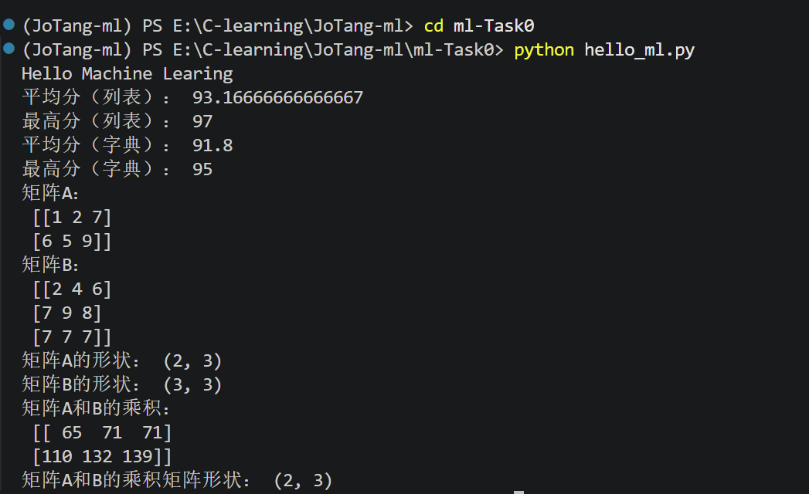
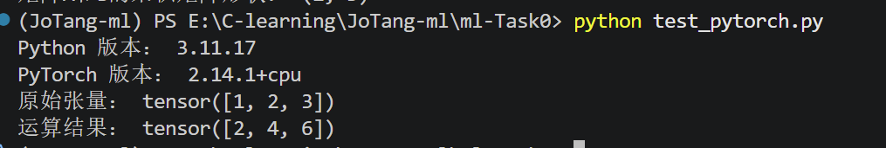
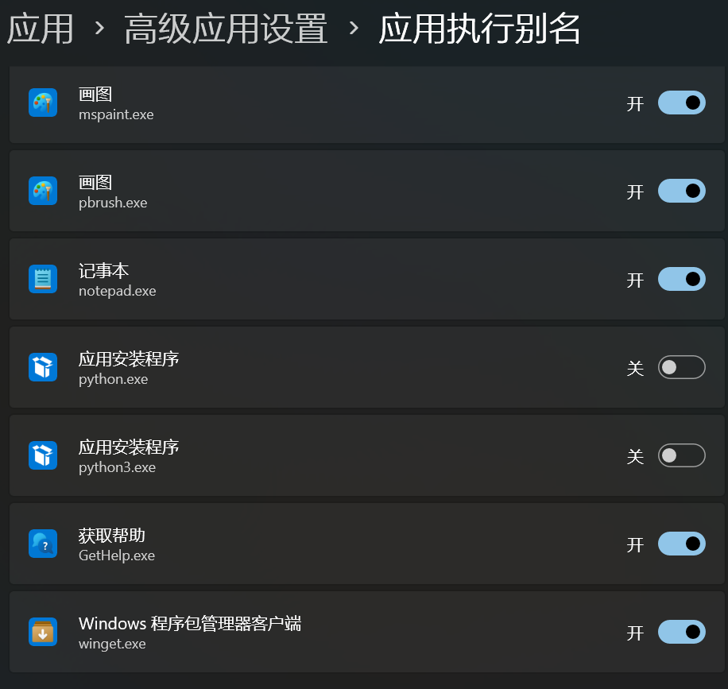
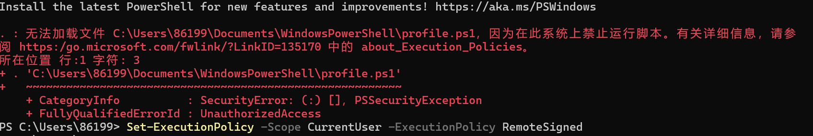

# 入门笔记
## 人工智能、机器学习与深度学习之间有什么关系？
人工智能：让机器拥有和人一样的智力去判断、决策、执行各种任务，甚至学习  
机器学习：实现人工智能的一种方法，利用数据，让机器学会找规律，进而推断新的信息  
深度学习：机器学习中的一类，通过海量数据和算力，让ai自己找规律去解释。
## 监督学习和无监督学习有什么区别？请各举一个例子。
- 监督学习：给机器喂数据，每个数据有对应的分类，让机器来找规律，进而去预测一张图片是猫还是狗。  
  eg. 猫狗分类，每张图片提前标注了是猫还是狗，再喂给机器
- 无监督学习：给机器喂数据，每个数据没有分类，让机器自己分类
  eg.猫狗分类，每张图片没有标注种类，让机器自己去区分，分类。
## 数据、特征和标签分别是什么？训练集、验证集和测试集各有什么用途？  
- 数据：输入的样本所带有的所有信息
- 特征：样本中用于机器预测所带有的关键信息
- 标签：需要预测的信息
- 训练集：人工标注好后让机器去找规律，比如猫和狗的照片，让机器找到其中的规律
- 验证集：在训练到了一种程度后，用于验证机器找的规律是否能正确预测，来进行一些细节调整
- 测试集：检测机器在面对未知数据的表现
## batch size是什么？有什么影响？
- Batch size是批大小，是模型每次读取样本的数目
- 过大每次读取多，但总次数就少，会导致可能拟合不精确，就像是100个人分数，直接画折线图，和每次取五十个人取平均值画折线图，前者拟合的直线会更精准
- 过小：次数多，时间长，迭代的多，可能变动大，还是100个人分数，两个两个取，前十个都是90左右，之后，突然一会儿【85，86，95】，一会儿【77，79，88】
## 什么是模型和模型参数？
- 模型：一种复杂结构，可以映射我们的输入和输入，但它本质还是拟合和预测没有理解，但过于复杂的结构，也导致我们对中间过程的具体变化无法了解。
- 模型参数：模型不断训练中需要调整的计算时的权重，让模型预测的更精准
## 神经网络由哪些基本部分组成？什么是激活函数？为什么要激活函数？请介绍几种常见的激活函数。
- 组成：
  1. 输入层:接受输入的数据
  2. 隐藏层：进行复杂的计算和变化
  3. 输出层：产生最终预测
  4. 权重和偏置：计算时的参数
  5. 激活函数：引入非线性
- 激活函数；
  1. 什么是：非线性函数
  2. 为什么要；通过激活函数才能让多层神经网络具有非线性能力
  3. 例如：
      - ReLU (Rectified Linear Unit)：f(x) = max(0, x)。负数输出0，正数不变。
      - Sigmoid：将输出映射到 (0, 1) 之间，常用于二分类概率输出。
      - Tanh：f(x)=tanh(X)把输入映射到(-1,1)，以0为中心。
## 矩阵如何求导？提前学习该部分数学。

## 怎么用矩阵乘法表示神经网络的全连接层前向传播过程？  （？）
- 公式：$Z = XW + b$
   1. $X$：输入矩阵，形状为 $(N, D)$，其中 $N$ 是 Batch Size，
   2. $D$ 是输入特征维度。$W$：权重矩阵，形状为 $(D, H)$，其中 $H$ 是隐藏层神经元数量。
   3. $b$：偏置向量，形状为 $(1, H)$（通过广播机制相加）。
   4. $Z$：未激活的输出，形状为 $(N, H)$。
   5. 随后，通过激活函数 $A = \text{ReLU}(Z)$ 完成非线性变换。矩阵乘法能够并行处理整个 Batch 的数据，极大提升计算效率。

## 前向传播与反向传播分别在做什么？损失函数、梯度和学习率在训练过程中扮演什么角色？
- 前向传播：数据从输入层顺着网络往后流动，通过矩阵乘法和激活函数，逐层计算出预测结果。
- 反向传播：从输出端逆向往回算。利用微积分的链式法则，计算损失函数对每个参数的偏导数，从而知道每个参数对错误率负有多大责任。
- 损失函数：衡量模型预测结果和真实情况的差距
- 梯度：损失函数对各参数求偏导得到的方向向量，指明参数应该朝哪个方向调整才能使损失减小最快
- 学习率；决定参数更新时的变化大小
## 优化器是什么？有哪些？
- 优化器：通过方向传播计算出的梯度来决定模型参数如何更新
- 例如：
  1. SGD (随机梯度下降)：沿着当前梯度的反方向直接更新。简单但容易在沟谷里震荡或陷入局部最优。
  2. Adam (Adaptive Moment Estimation)：结合了一阶矩估计和二阶矩估计，能自适应调整每个参数的学习率。
## 什么是过拟合，欠拟合，正则化？  
- 过拟合：将一些其实不影响结果的偶然因素当成判断时的必要条件，导致通过训练集但是在其他数据上验证时判断错误率高
- 欠拟合：拟合不充分，训练集都难以较高成功判断通过
- 正则化：防止过拟合的限制技术

#  Python 热身  
## 1. 使用列表或字典记录几组姓名与成绩；  
   列表list：  `a=[1,2,3]``list[0]=1`  
   字典dictionary:  `b={key1:value1,key2:value2}`  
## 2. 编写函数计算平均分，并找出最高分；
   1. `averge_dic=sum(student_scores.values())/len(student_scores)`通过sum来求总分，len来求总人数，最后得出均分
   2. 通过max()直接找到最高分
## 3. 使用 NumPy 创建两个形状合适的矩阵，完成矩阵乘法；    
   ```
import numpy as np  //引入numpy库

A = np.array([
    [1, 2],
    [3, 4]
])
  # 定义矩阵
B = np.array([
    [5, 6],
    [7, 8]
])

C = A @ B 
# 使用@完成矩阵乘法  

   ```
## 4. 输出计算结果以及输入、输出矩阵的形状；
通过`.shape`来查看形状，也就是几行几列  

## 5. 在终端中运行程序，并把运行命令和结果记录到笔记中。
运行命令
```
python hello_ml.py
```  
结果 


# 开发环境  
## 为什么不同项目最好使用不同的 Python 虚拟环境？  
不同项目一般是不同的需求，项目所需要的工具库可能不同，版本可能有所不同，只在一个环境下完成不同项目，可能会因为不同工具所兼容的python版本不同而导致报错，并且每次新开项目需要考虑之前所有项目，避免影响。在github上也是一个项目一个仓库，多个项目一个仓库明显会有更高的风险和管理成本。
## CPU 和 GPU 各自擅长什么？训练神经网络为什么经常使用 GPU？  
CPU 擅长单线计算，GPU擅长多线并行运算。    
训练神经网络因为是使用大型复杂的矩阵，这种运算更适合多线运算的GPU实现。
## CUDA 是什么？它、显卡驱动与 PyTorch 之间大致是什么关系？
CUDA是英伟达推出的一种模型或者说工具，它能调控显卡，让显卡渲染图形或者不渲染图形，进而全部用于科学计算  
显卡驱动是操作系统怎么去使用显卡，而CUDA是显卡的一种调用方式，PyTorch需要显卡来完成计算工作。
## 编写测试代码，输出 Python 和 PyTorch 的版本，完成一次 PyTorch 张量运算；  
通过[test](./test_pytorch.py)  



# 过程问题  
## anaconda  
### 相关指令  
```  
conda info --envs  
conda create -n jotang-ml python=3.11  //创建一个名字为jotang-ml python版本为3.11的库  
conda activate JoTang-ml  //切换虚拟环境，沙盒  
python -m pip install numpy matplotlib scikit-learn  //安装库 numpy数学计算工具 matplotlib画图工具  scikit-learn 包含一些机器学习算法
```  
## vscode无法正确连接到下载的python，导致无法使用
VS Code 中输入 `python --version`和 `where.exe python`没有输出或者出现的是系统中不知名程序（后头发现是应用执行别名
  

之后就尝试连接，发现在初始化powershell时会弹出警告，发现原因是conda的脚本会修改powershell相关配置文件来让相关`conda xxx`指令能够被识别，但是被阻止了，  

于是就让该脚通过指令` Set-ExecutionPolicy -Scope CurrentUser -ExecutionPolicy RemoteSigned`让脚本执行就成功连接了。  
## 重启终端是默认base环境  
通过重新选择虚拟环境后，每次新开终端会先是base环境然后自动键入`conda activate JoTang-ml`转到对应虚拟环境  
