# Task01  
## 任务
- 可视化原始数据（选择你喜欢的方式），并按训练/验证/测试集划分；说明三者职责，避免数据泄漏。
  1. 可视化：通过`c=y`c就是color，然后y是它的标签只有0，1画出来就是两个半月
    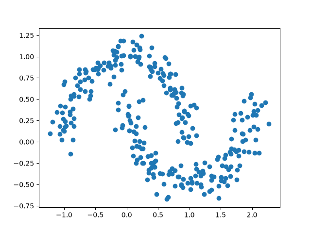
    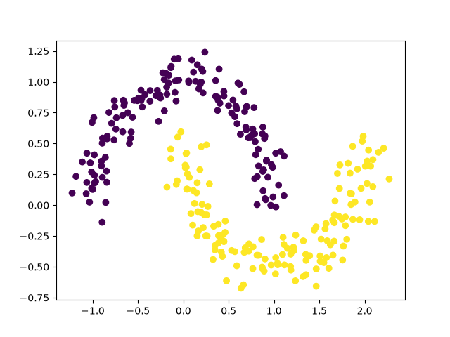
  2. 训练集：用于训练拟合 
  3. 验证集：用于验证拟合效果和继续调整参数
  4. 测试集：测试最终拟合效果
  5. 通过`from sklearn.model_selection import train_test_split`调用函数实现划分
   ```
   X_train,X_temp,y_train,y_temp=train_test_split(
    X,
    y,
    test_size=0.3,
    random_state=4
    )  
   ```
   将生成的数据拆分成三组，但是原来的变量名中依然有数据
    ```  
    python dataset.py
    (300, 2)
    (210, 2)
    (45, 2)
    (45, 2)  
    ```
- 使用torch搭建至少包含一个隐藏层的 MLP，完成训练、验证、测试和模型保存/加载。
  1. torch是PyTorch主库，引入torch
  2. 选择了relu作为激活函数
  3. 需要一开始的训练集数据，把之前那个文件中改成函数，方便调用，但是这样子就不好再使用matplotlib显示图片，所以我又单独建了一个文件。
  4. 我先通过`torch.save`保存训练好的参数，然后再用于测试
  5. 不对，怎么第二次运行loss变大了，嘶，。。。保存了参数但是没加载有什么么用。。。。
  6. 编写了[val.py](./val.py)加载保存的参数用于验证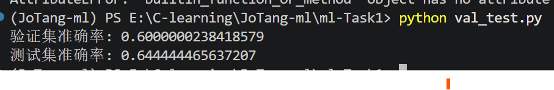
- 绘制 loss、accuracy 曲线及二维决策边界。  
  我在[train.py](./train.py)中添加了一段代码，将当次训练的loss保存在一个文件中，然后通过[visual_loss.py](./visual_loss.py)调用这个文件，画出来
  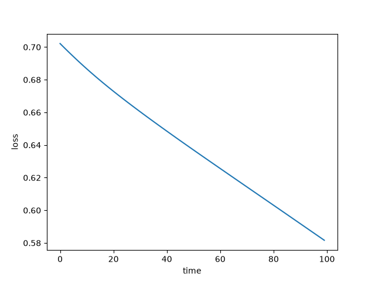
  但我现在有一个问题了，loss必定是下降的吗？loss为什么不会再调整后变更大，只会一直变小。优化器就是为了朝更小的方向调整，只不过有时调整不合理会导致增大
  准确率同样加了`visual_accuracy`来实现
  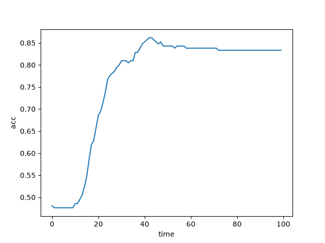
  前面接近50%，后面陡增，最后还下降了，前面一开始相当于随即猜测所以接近50%，后面找到规律，但最后为了整体loss？牺牲了部分accuracy  ,应该是过拟合了，记住了一些个别边界线附近的点，但是确实强行贴合，不符合规律，反而导致accuracy下降
  二维决策边界（2D Decision Boundary）是机器学习和统计分类中，在二维特征空间中用来划分不同类别数据的一条线或曲线。  
  [decision](./visual_decision.py)  
  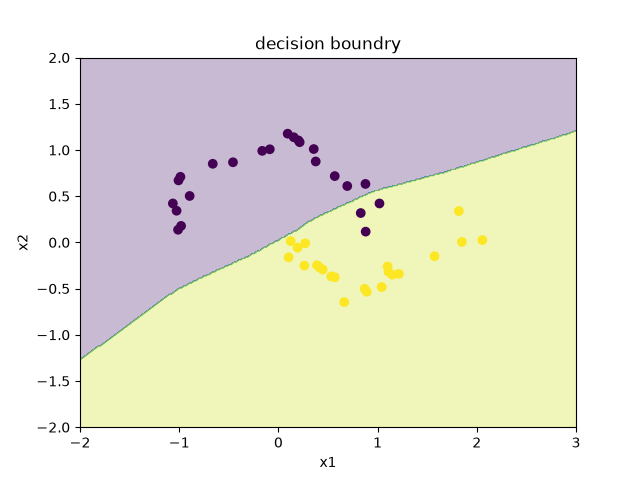
  看起来就是一条比较弯曲的斜线，大概是训练次数少，用于训练和测试的的数据比较少 
- 至少改变两个因素做对照实验，例如隐藏层宽度、层数、激活函数、学习率、优化器、batch size 或数据噪声。一次只改变一个主要变量。观察模型训练各个指标（速度，显存等），还有结果变化。
  
  坏，`torch.manual_seed()`之前只固定了数据集的划分和数据集的生成，没有固定权重这些的初始值
   
    |   实验 | 学习率  |激活函数   |loss|隐藏层宽度|时间/s |
    |  ----  | ----   |------|----|  --|---|
    | 原实验  | 0.001 |relu() |  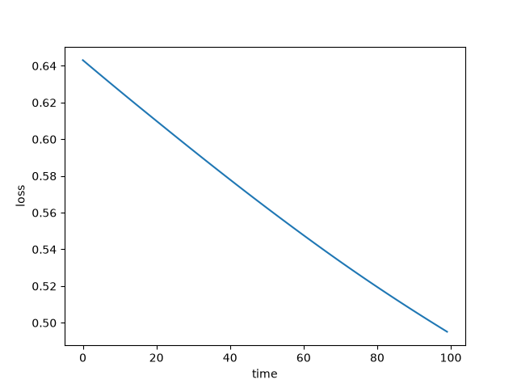 |16 |   6.4791038036346436|
    | 更改学习率 | 0.01|relu() | 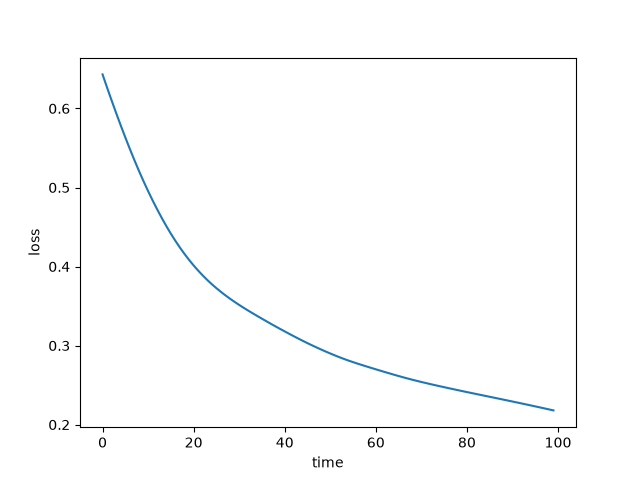 |16 |   5.473268032073975|
    |更改激活函数| 0.001 |tanh() |  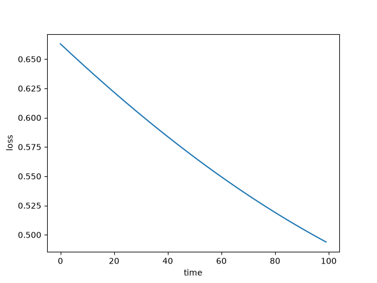 |16 |  5.608135223388672 |
    |更改隐藏层宽度| 0.001 |relu() | 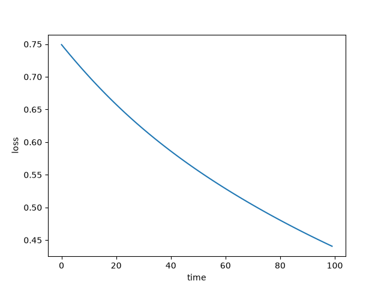  |64 |  5.6184492111206055 |  
    
  调高学习率后，loss下降快，略微凹陷，前快，后面慢点  
  更换激活函数后初始loss高点，但曲线下降快慢没什么区别  
  提高隐藏层后初始loss高，但是最后loss低

- 输出混淆矩阵，并挑选几个模型判断错误的样本分析。
  我在`val_test.py`输出了混淆矩阵
  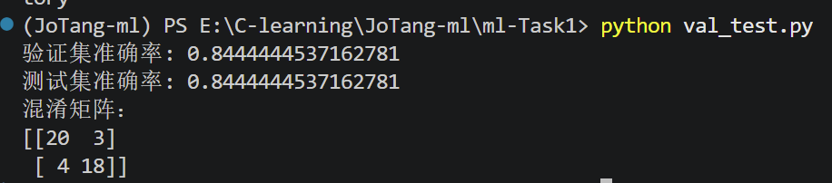

  尝试输出错误样本，我一开始用  
  ```  
  wrong=np.where(pred_numpy!=y_numpy)[0] #    取第一个数组

    print("wrong numburs:")
    print(wrong)

    for i in wrong :

    print("position :",X_test[i],"TRUE:",y_test[i],"prediction:",prediction[i])

  ```
  结果输出不仅多，而且还是张量 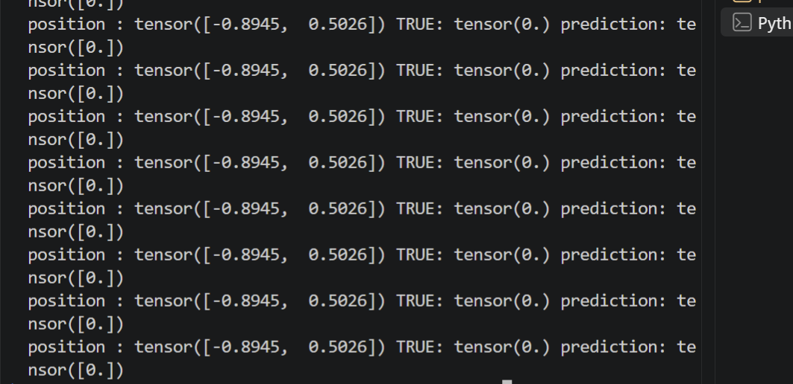
 ! [wrong](./png/wrong_00_44.png)  
 直接重复输入，可能是`y_numpy` `pred_numpy`不匹配
 ```  
  pred_numpy = prediction.numpy().reshape(-1)
    y_numpy = y_test.numpy().reshape(-1)
 ``` 
 修改后就正常了
 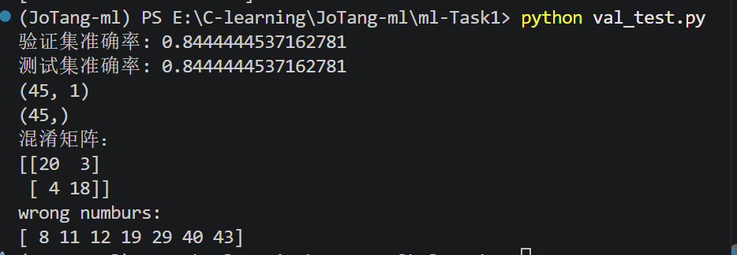
 对比出问题的点和最开始的moon图，有部分点是在分界线位置  
 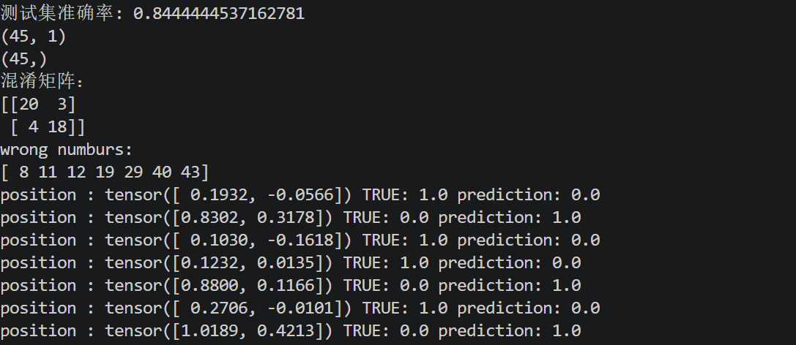  
 

## 趁热打铁  
- 你在这个任务之中，选择了什么激活函数，为什么选这个？
  我最开始选择了relu(),因为查到的资料普遍推荐，认为其具有计算优势，并且属于我知道的几个激活函数中，就直接使用，后续尝试了tanh()，大概是我模型小，数据小，差距不明显，主要都是提供一个非线性
- 你选择了什么损失函数？为什么？那如果这一题是三分类问题呢？
  我选择了BCE损失函数，因为二分类这个最常用，用于计算预测与真实的差距  
  三分类则是Cross-Entropy Loss（CE）
- optimizer.zero_grad()、loss.backward() 和 optimizer.step() 分别完成了什么工作？如果不清空梯度会发生什么？
  1. 清空梯度
  2. 计算反向传播，梯度，用于优化
  3. 更新计算出的梯度
- 更深、更宽的神经网络一定能取得更好的效果吗？模型过于简单或过于复杂分别可能带来什么问题？
  1. 不一定，不同规模问题应该选择其合适大小的网络。
  2. 过于简单，难以拟合复杂多特征数据
  3. 过于复杂，容易把偶然理解成规律，导致本来简单的规律，被复杂化，就像描点画图过于耿直，而不是平滑曲线以及忽略不合理数据
- 学习率过大或过小会怎样影响模型训练？你能从 loss 曲线中观察到哪些现象？ 
  1. 学习率过大，loss下降快，前快后慢，但过大，或导致偏离最合适的权重参数
  2. 过小，loss下降慢
- 假设还有一个分类问题，但是两个类别的样本数量非常不均衡，训练出来的模型会怎么样？为什么？说明了什么？ 你可以尝试构造一个数据集试试看
  1. 训练出来的模型可能只对数量大的样本数据敏感  
  2. 因为训练数据少，说明模型拟合能力与训练数据的样本数量有关系  
- 如果想要过拟合这个数据集，你会怎么做？为什么？试试看能不能实现吧！（在别的数据集也可以）训练过程和数据呈现和正常训练有何不同？你通过什么判断他过拟合？ 
  1. 减少数据，增加隐藏层复杂度，增加训练次数
## 学习笔记  
### 查找了关于make_moons的相关用法  
- 从[make_moon](https://scikit-learn.org/stable/modules/generated/sklearn.datasets.make_moons.html)和[博客园](https://www.cnblogs.com/SupremeBoy/p/12247837.html)  
```  
n_numbers:生成样本数量
shuffle:是否打乱，类似于将数据集random一下
noise:默认是false，数据集是否加入高斯噪声,让数据有变化，不那么规范
random_state:生成随机种子，给定一个int型数据，能够保证每次生成数据相同。

sklearn.datasets.make_moons(n_samples=100, shuffle=True, noise=None, random_state=None)  

```
### 可视化
```  
import matplotlib.pyplot as ps
ps.scatter(
    X[:,0],
    X[:,1],
    c=y
)  
```  
我运行发现没有弹出窗口，发现原来是漏了一行输出`ps.show()`😓

### 关于训练时的输出
最开始出现报错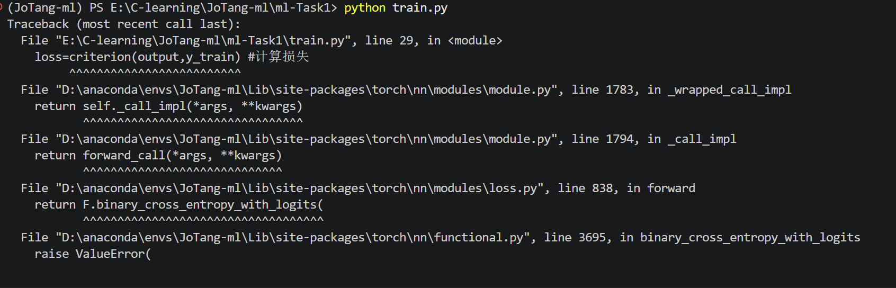

问题应该出在这里  
```  
loss=criterion(output,y_train)
```
output的数据是210行1列的矩阵，但是y_train是210列，所以需要修改y的数据格式  
通过询问ai和搜索浏览器，用reshape来实现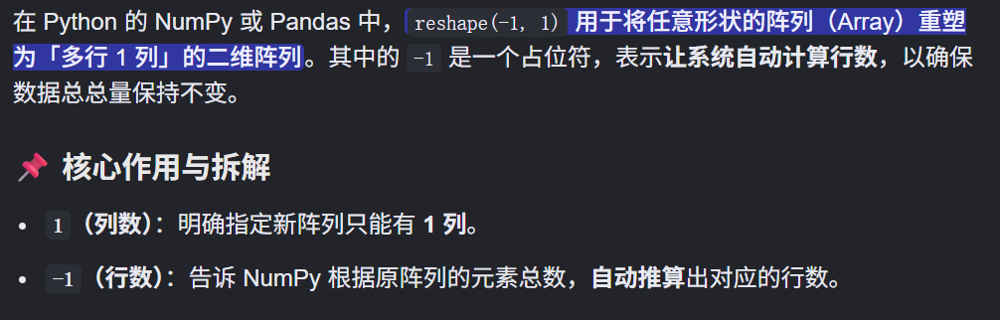

### 第一次输出
第一次输出出来，就发现不对劲的地方了，我把打印的参数设置成了总循环次数，全是100 (；′⌒`)
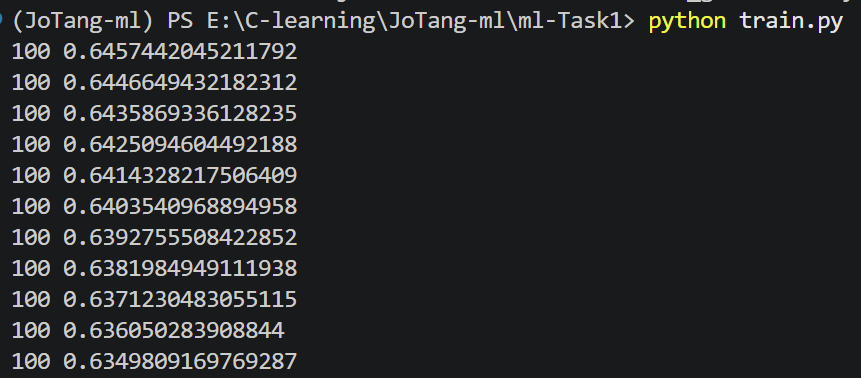
