# note  
## 实践一  
1. 了解数字图片如何被表示  
      - 像素是什么？
        图片组成的最小单位，图片由许多像素点组成
        那么印象中有的图片可以无限放大？查到资料显示，那种是矢量图，本质是记录怎么画，然后显示出来，基本上只是线条，所以可以一直放大  

      - 什么是 RGB？
        R->red
        G->green
        B->blue  
        红绿蓝，电视，显示器放大到很小后，会看见三色灯管，图片所有颜色在显示器上面显示出来都是这三种颜色不同程度的混合  

      - 灰度图和彩色图有什么区别？  
        灰度图每个像素点只区分从白色到黑色  
        彩色图每个像素点都有三个不同颜色的不同强弱下的叠加  
2. 使用上面这张图片，用 Pillow 或其他图像读取工具将它转换为 NumPy 数组和 PyTorch Tensor。打印他的的 shape、dtype、最大值和最小值，再打印一个像素的 RGB 数值。说明每个维度和数值分别表示什么，以及 NumPy/Pillow 常见的 HWC 与 PyTorch 常见的 CHW 排列有什么区别。  
    - 打印  
    - 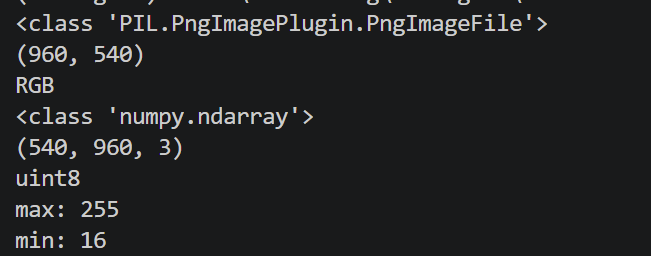  
        ```
            (540, 960, 3) 高度，宽度，颜色数
            uint8 dtype 无符号八位整数，用于表示像素亮度
            max: 255 最大亮度
            min: 16  最小亮度
        ```
    - 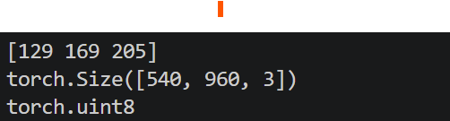  
    - 增加了输出单个像素点（100，100）和转换张量并输出  
    - HWC与CHW；H:高，W:宽，C:颜色，两者是数据输入顺序的区别
3. 了解二维卷积的基本过程。用自己的话解释：卷积核是什么？它在图片上怎样移动？每到一个位置进行了什么计算？  
   -   卷积核是一个小矩阵，是一个判断工具，卷积核通过计算来判断是否是某样东西，比如眼睛
   -   从左到右，从上到下  
   -   矩阵对应位置相乘
4. 仅使用 Python 和 NumPy，手写一个能够处理灰度图或 RGB 图片的二维卷积函数。核心卷积过程不能调用 cv2.filter2D、scipy.signal.convolve2d、torch.nn.Conv2d 等现成实现。
   - 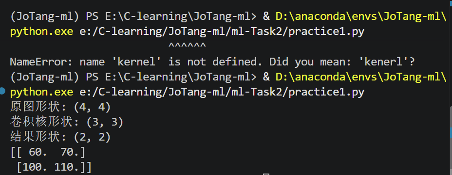  
   - 一开始睡迷糊了，变量名打混乱了，写了一个全为1的3x3卷积，然后通过forfor嵌套循环处理图片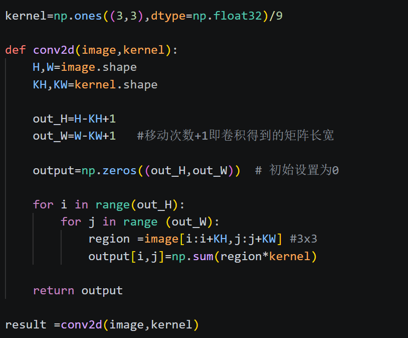
   - 同样的，处理RGB，只需要在循环外面加一个循环三次，分别处理R,G,B
   - 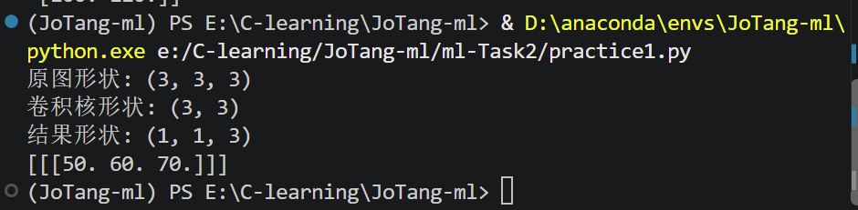
5. 至少使用下面四种卷积核处理同一张图片，把原图和结果放在一起比较：
均值模糊：使用 3×3 的均值卷积核；
高斯模糊：使用 5×5 的高斯卷积核，可以查阅高斯函数并自行生成或填写卷积核；
锐化：例如使用 [[0,-1,0],[-1,5,-1],[0,-1,0]]；
边缘检测：使用 Sobel-X 和 Sobel-Y，尝试把两个方向的结果合成为一张边缘图。  
   - 使用[practice1](./practice1.py)实现
   - 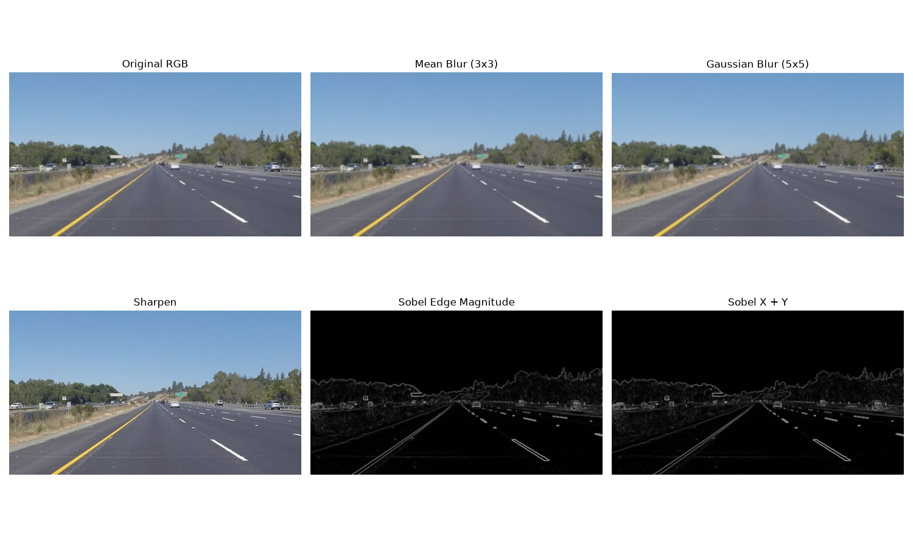  
   - 均值模糊：更模糊，因为计算的周围平均值  
   - 高斯模糊：变模糊，但没有那么模糊  
   - 锐化 ：加强了点，细节更突出  
   - 边缘检测：突出物体轮廓，不同颜色的交界处  
6. 观察并解释每种处理带来的变化：
   - 为什么均值与高斯卷积会让图片变模糊？计算周围平均值和按权重计算，但是都相当于让自己这个点与周围更加接近，所以模糊
   - 为什么锐化会让边缘更明显？Sobel 卷积核为什么能找到边缘？ 锐化加强了自己这个点，sobel分别计算左右两边，或者上下的和值，来计算变化大小
7. 分别尝试不填充（valid）和适当填充（same）图片边缘，比较输出尺寸与边缘像素的变化。记录卷积核大小、padding、stride 与输出尺寸之间的关系。  
   - 不填充会导致形状变小，因为卷积大小大于（1，1），会导致图片大小缩小  
   - 填充我填的是0，也就是黑色，所以边缘像素变化，可能更暗
   - 在其他条件不变时，卷积核越大，输出尺寸通常越小；填充扩大原图片，保证新图片大小与原图片一致或接近；在其他条件不变时，步长越大，输出尺寸越小。
8. 图像卷积完成后，部分结果可能小于 0 或大于原来的像素范围。保存图片以前想一想应该怎样处理这些数值。
   - 截断：只取0-255
   - 取绝对值：边缘变化，正负都是变化，只看绝对值大小判断变化大小
   - 归一化：映射到0-255  


## 实践2  
1. 一开始做就出现问题了，kaggle中该文件下不了，登陆账号并且同意规则，但是一直通过不了，后面试了半天才发现需要验证手机号，最终我从网上找了另一份数据集
2. 我尝试先保存上传一部分，结果发现超过100mb的单个文件竟然不能上传ㄒ-ㄒ，于是把zip忽略了
3. 下载并观察数据集，统计猫和狗各有多少张；随机展示一些图片，看看它们的尺寸、清晰度和拍摄背景是否相同。
   - 猫狗训练用数据集各4000张
   - 随即展示图片，大小，拍摄背景均不同
   - 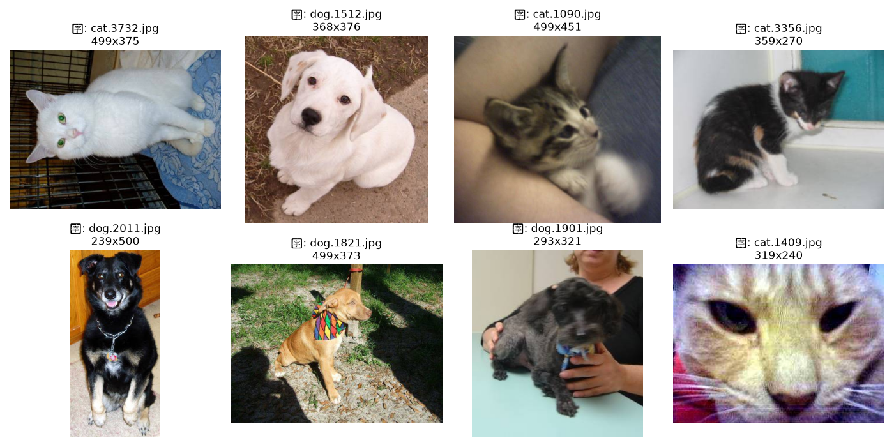
4. 为猫狗图片编写数据读取与预处理流程。你准备怎样把它们组成一个 batch？随机展示预处理前后的图片，检查是否出现拉伸、裁剪错误或颜色异常。
   - [pre](./show_number.py)
   - 尺寸大小不一样，我保证宽高比的情况下放大或缩小，然后其余地方填充灰色方块
   - 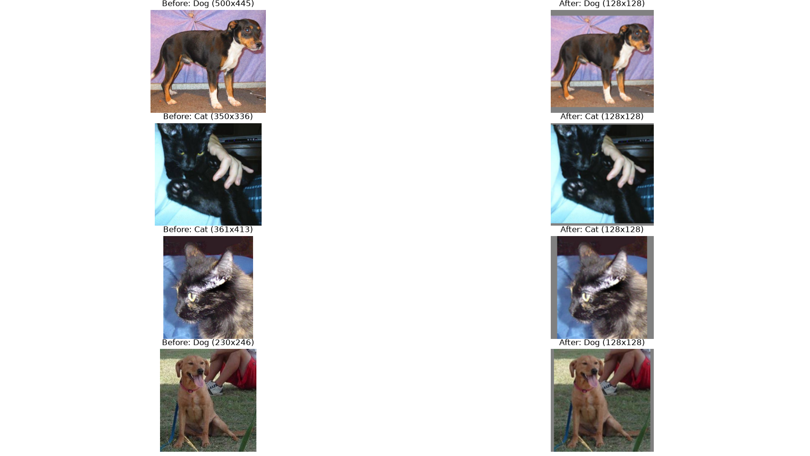
   - 变化后，像素点变少，图片更糊
   - 我打算batch设置为8，因为有八千张，（其实就是随便选的，之后再尝试一下啊16，32
5. 搭建一个包含卷积层、激活函数和池化层的 CNN。
   - [model](./model.py)
6. 记录一张图片经过 CNN 各层后的 Tensor 形状，说明宽、高和通道数发生了什么变化。  
   
    | 层 | Tensor 形状（ | 变化说明 |
    |---|---|---|
    | 输入图片 | `[3, 128, 128]` | 3 个 RGB 通道，宽、高均为 128 |
    | `Conv2d(3,16,3,padding=1)` | `[16, 128, 128]` | 通道数 3→16，宽、高不变 |
    | `ReLU()` | `[16, 128, 128]` | 形状不变，对特征值进行非线性处理 |
    | `MaxPool2d(2)` | `[16, 64, 64]` | 通道数不变，宽、高减半 |
    | `Conv2d(16,32,3,padding=1)` | `[32, 64, 64]` | 通道数 16→32，宽、高不变 |
    | `ReLU()` | `[32, 64, 64]` | 形状不变 |
    | `MaxPool2d(2)` | `[32, 32, 32]` | 通道数不变，宽、高减半 |
    | `Conv2d(32,64,3,padding=1)` | `[64, 32, 32]` | 通道数 32→64，宽、高不变 |
    | `ReLU()` | `[64, 32, 32]` | 形状不变 |
    | `MaxPool2d(2)` | `[64, 16, 16]` | 通道数不变，宽、高减半 |
    | `AdaptiveAvgPool2d((1,1))` | `[64, 1, 1]` | 每个通道的特征图压缩为一个数值 |
    | `torch.flatten(x, start_dim=1)` | `[64]` | 将 64 个通道的值展平为 64 个特征 |
    | `Linear(64,1)` | `[1]` | 将64个数输出为一个数来判断猫狗 |  

7. 从测试集中选择几张图片，将第一层或最后一层卷积输出的部分特征图可视化。不同通道对同一张图片产生了什么结果？它们可能关注颜色、边缘、纹理还是其他信息？  
   - [file](./visual.py)
   - 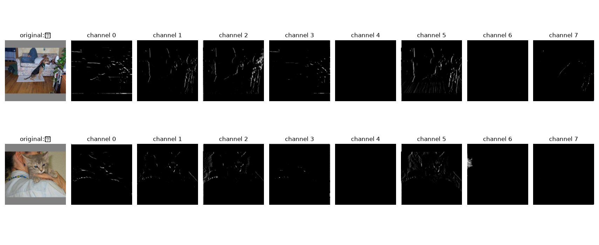
   - 产生不一样的结果
   - 有的关注明暗交接处，有的关注局部亮度
8.  设计一组有关数据增强的对照实验，例如“无增强”与“随机水平翻转、随机裁剪或颜色扰动”。展示增强后的样本，并分析哪些变换可能合理，哪些变换可能破坏标签或让图片失真。
   - 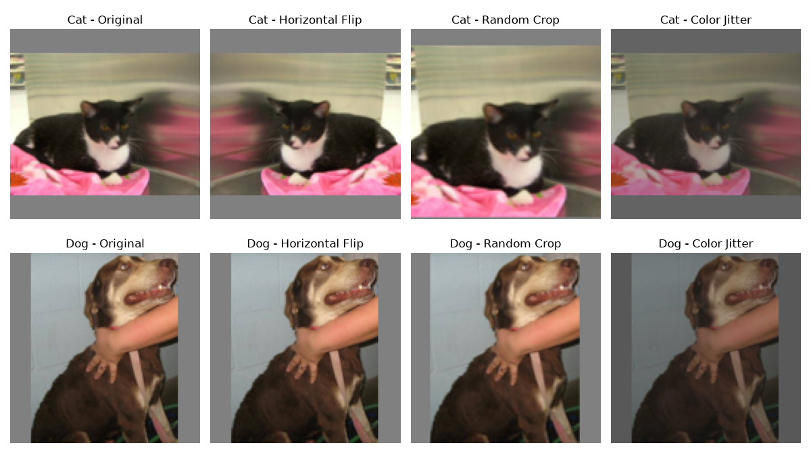
   - 水平翻转：合理，相当于换个角度拍照
   - 裁剪：不太合理，可能丢失细节，本来就只有半边身子，最后可能只有头或者眼
   - 颜色：有一定合理，模拟光源不同位置
9.  查看模型预测错误的样本，分析原因？看看能不能做出相应改进？记录下这个过程。
    - [file](./check_errors.py) 
    - 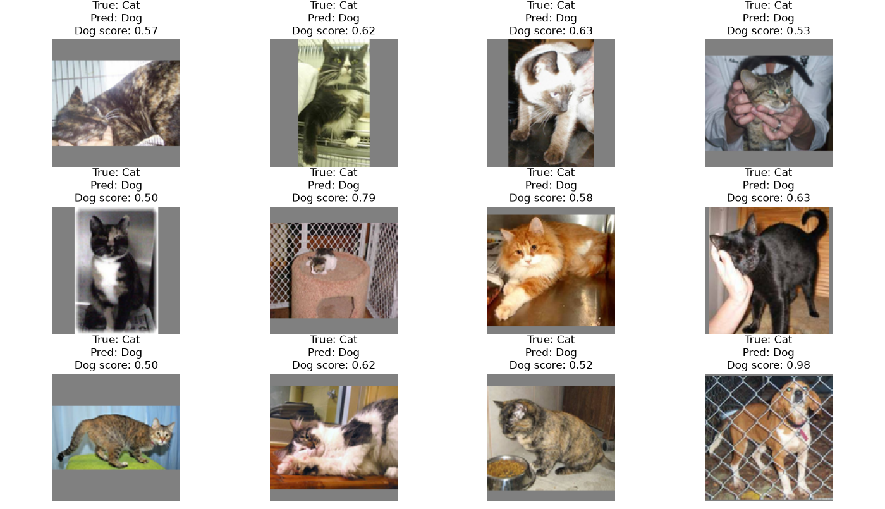
    - 原因：训练次数；主体过小，背景过于突出
    - 增加训练次数，加入数据增强
10. 保存你认为表现最好的模型，并编写一个独立的推理程序：输入一张本地图片，程序自动完成与训练时一致的预处理，输出“猫/狗”、预测概率和处理后的图片。
    - [file](./predict.py) 
    - 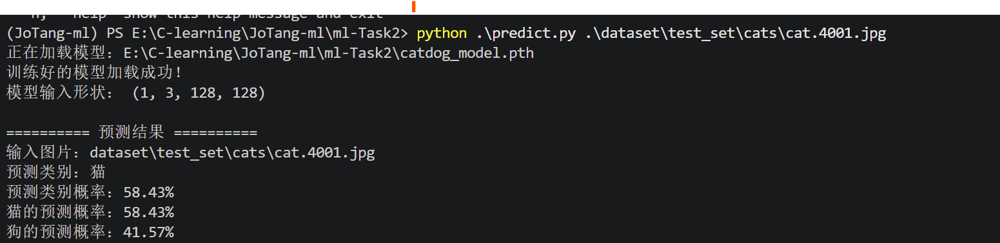
11. 绘制你的模型结构图。
    - 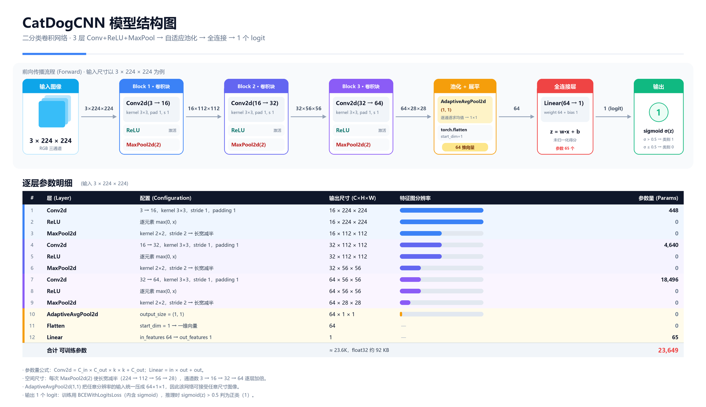
## 趁热打铁 
1. 卷积层为什么比直接使用一个巨大的全连接层更适合处理图片？试着用全连接层试试看实现本任务？对比一下差距
   - 一个巨大的全连接层参数过大，计算负担过大
2. 卷积层的输入通道和输出通道分别表示什么？它们与卷积核的数量有什么关系？
   - 输入通道：输入的特征图数
   - 输出通道：生成的特征图数
   - 每个输出通道对应一个卷积核组，每个特征图都是一卷积核组（因为rgb，每个图是三个数据，所以是卷积核组3x3x3）
3. padding、stride 和 pooling 会怎样改变特征图的尺寸？请结合自己网络中的一层实际计算。
   - padding:补充边缘信息，可以一定程度上恢图片大小
   - stride；移动步长，步长越大，计算次数越少，输出的特征图也越小
   - 对局部区域进行汇总，缩小特征图
4. 随着网络逐层计算，特征图的宽和高通常越来越小，通道数却可能越来越多，这是为什么？
   - 代表把原来的一张图，提取成多个特征图。
   - 宽高越来越小，减少后续计算量，扩大特征提取
   - 通道数增加，提取到的特征更多
5. 你选择了什么激活函数和损失函数？它们为什么适合这道二分类题？
   - 选择了relu（）激活函数，引入非线性，计算简单
   - BCEWithLogitsLoss，输出0-1，适合分辨二分
6. 为什么训练集上的随机数据增强不应该原样用在验证集和测试集上？翻转、裁剪和颜色变化分别可能带来什么帮助或问题？
   - 训练集使用数据增强可以增加样本多样性，验证集和测试集用于评估，要保证每次输入的一致性，如果加入随机变化，不利于评估
   - 翻转：增加不同朝向，提高不同方向模型适应力
   - 剪裁：适应不同位置变化；可能丢失关键特征
   - 颜色变化：提高颜色变化适应力；变化过强可能丢失颜色细节